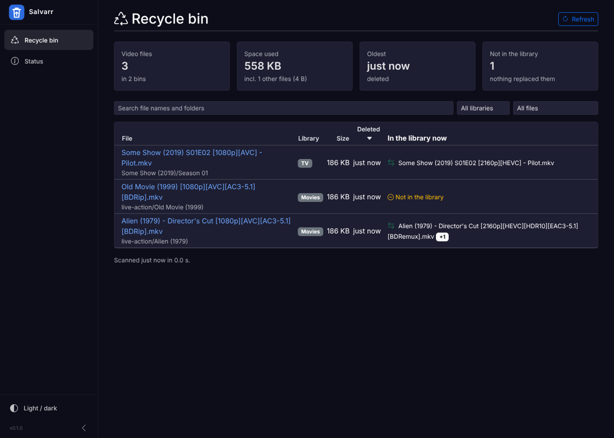
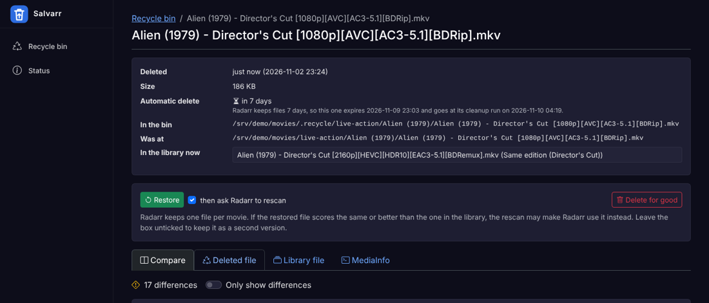
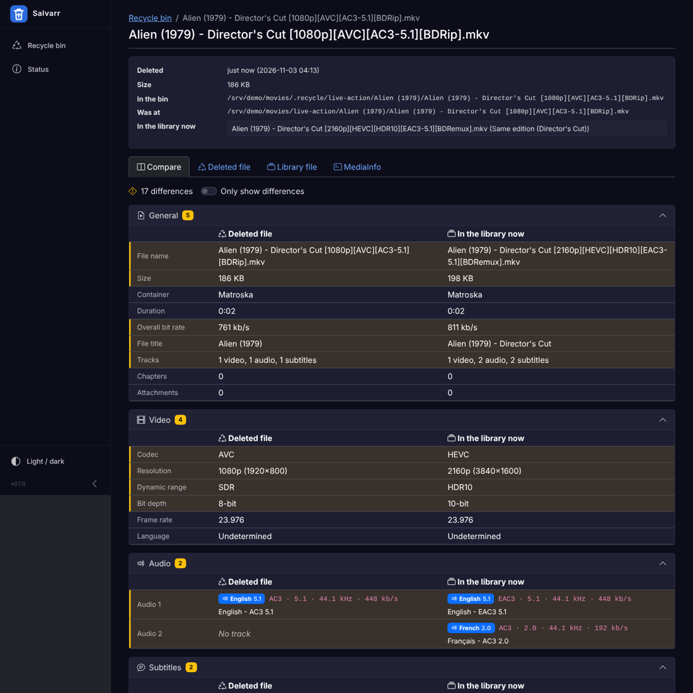

# Salvarr

Browse the recycle bins of a Radarr/Sonarr media library, read each deleted
file's media info and MKV tags, and compare it side by side with the file that
replaced it in the library.

Salvarr is read-only unless you turn on changes: then it can also restore a
file to where it was (and ask Radarr or Sonarr to rescan) or delete it for good.







## What it does

- **Recycle bin list.** Every video file in the `.recycle` folders of `/movies`
  and `/tv`, with size, when it was deleted, and which library file replaced it.
  Search, filter by library, and sort by name, size or date.
- **File page.** Tracks (codec in Radarr's words, resolution, HDR10, HDR10+, HLG,
  Dolby Vision profile, Atmos, DTS:X, channels, language, track name and flags),
  chapters, attachments, and every MKV global tag (TMDB, IMDB, RELEASE_NAME,
  SOURCE, EDITION and the rest of what `tag_release.py` writes).
- **Audio bit rates.** Lossless tracks (TrueHD, DTS-HD MA, FLAC) only store one
  when mkvmerge wrote its statistics tags. Without them Salvarr uses mediainfo's
  average, else measures the audio packets in 6 samples of 10 s (shown as
  `≈ 4.2 Mb/s`, filled in a few seconds after the page opens), else shows the
  peak from the stream header (`up to 9.6 Mb/s`).
- **Dolby Vision.** dovi_tool reads the RPU of the first 500 frames: profile 7
  FEL or MEL, CM v2.9 or v4.0, scene count, mastering display, L1 MaxCLL and
  MaxFALL, L2/L8 trims, L5 offsets, L6, L9 and the rest of its summary.
  "Read the whole film" reads every frame for the film's real L1 brightness.
- **Compare.** The deleted file and the library file in two columns, with every
  row that differs highlighted: general facts, video, each audio and subtitle
  track by position, Dolby Vision, tags and chapters. "Only show differences" hides the rest.
- **MediaInfo.** The raw `mediainfo` output or ffprobe JSON of either file.
- **Automatic delete.** With Radarr and Sonarr set up, Salvarr reads their recycle
  bin folder, how many days they keep files and when their "Clean Up Recycle Bin"
  task runs next, and shows how long each file has left (red under a day).
  Their bin is listed even if it is not called `.recycle`.
- **Restore** (changes on). Moves the file, with its subtitles or NFO of the same
  name, back to where it was, then asks Radarr or Sonarr to rescan that movie or
  show. It never overwrites a file. Radarr and Sonarr keep one file per movie or
  episode, so if the restored file scores the same or better, the rescan may make
  them use it; untick "rescan" to keep it as a second version.
- **Delete for good** (changes on), one file or every listed file deleted more
  than N days ago.
- **Status.** Libraries, the bins found, Radarr and Sonarr settings, whether
  changes are on, and the tool versions.

## How it finds things

**Recycle bins** are folders named `.recycle` (configurable) inside each
library root, up to two levels deep: `/movies/.recycle` and
`/movies/live-action/.recycle` are both found.

**When a file was deleted** is the later of its change time (moving a file
into the bin sets it) and its modification time (Radarr and Sonarr set it).

**When Radarr or Sonarr will delete it**: their cleanup deletes a file at the top
of the bin once its modification time is older than the cleanup days, and a
folder at the top of the bin (`Alien (1979)/`) as a whole once its newest file
is. Salvarr works out that moment, then the first cleanup run on or after it.
Files in other bins (a Samba bin, say) show no time.

**The library file** is found in two steps:

1. The movie or show folder. Samba's recycle bin keeps the whole path
   (`.recycle/live-action/Alien (1979)/...`), Radarr and Sonarr keep only the
   title folder (`.recycle/Alien (1979)/...`). Salvarr checks each folder name in
   the bin path against the library's movie and show folders, then falls back to
   the title at the start of the file name (`Alien (1979) - ...`).
2. The file in that folder. For movies, the same file name wins, then the same
   edition (`Title (YYYY) - Edition [...]`), then any other cut. For TV, the same
   `S01E02` anywhere in the show folder. When there are several, the file page
   has a list to pick from.

## Running it

Add the service to the compose file (see [compose.example.yaml](compose.example.yaml)):

```yaml
  salvarr:
    image: ghcr.io/yannb2/salvarr:dev
    container_name: salvarr
    user: 1000:1000
    environment:
      TZ: America/Toronto
      Salvarr__Radarr__Url: http://radarr:7878
      Salvarr__Radarr__ApiKey: ${RADARR_API_KEY}
      Salvarr__Sonarr__Url: http://sonarr:8989
      Salvarr__Sonarr__ApiKey: ${SONARR_API_KEY}
      # Salvarr__AllowChanges: "true"        # restore and delete; also drop :ro below
    ports:
      - 8184:8184
    volumes:
      - /movies:/movies:ro
      - /tv:/tv:ro
    restart: unless-stopped
```

Salvarr must see the files under the same paths as Radarr and Sonarr (`/movies`,
`/tv`), so their recycle bin path and movie folders match.

Then open `http://<host>:8184`. The image is on the GitHub Container Registry:
`dev` follows `main`, `latest` and `0.1.0` come from release tags.

### Dashboard

`GET /api/stats` returns totals for a dashboard such as Homepage's custom API
widget (read-only, no key): `files`, `totalBytes`, `movies`, `episodes`,
`deletedToday` (last 24 hours), `expiringSoon` (deleted automatically within
24 hours), `bins` and `scannedUtc`.

### Settings

Everything has a default, and any setting can be changed with an environment
variable (`__` separates levels, lists are numbered from 0):

| Setting | Default | Environment variable |
| --- | --- | --- |
| Libraries | Movies at `/movies`, TV at `/tv` | `Salvarr__Libraries__0__Path=/movies`, `..._Name`, `..._Kind` (`Movies` or `Series`) |
| Recycle bin folder names | `.recycle` | `Salvarr__RecycleFolderNames__0=.recycle` |
| How deep to look for bins | `2` | `Salvarr__SearchDepth=2` |
| Look for HDR10+ (reads 5 frames) | `true` | `Salvarr__DetectHdr10Plus=false` |
| Read Dolby Vision details with dovi_tool (first 500 frames) | `true` | `Salvarr__ReadDolbyVision=false` |
| Measure audio bit rates the file does not state (6 samples of 10 s) | `true` | `Salvarr__EstimateAudioBitRate=false` |
| Restore and delete | off | `Salvarr__AllowChanges=true` (and mount the libraries read-write) |
| Radarr | not used | `Salvarr__Radarr__Url=http://radarr:7878`, `Salvarr__Radarr__ApiKey=...` |
| Sonarr | not used | `Salvarr__Sonarr__Url=http://sonarr:8989`, `Salvarr__Sonarr__ApiKey=...` |
| Look for newer tool versions once a day | `true` | `Salvarr__Updates__Enabled=false` |
| Port | `8184` | `ASPNETCORE_HTTP_PORTS=8184` |

## Tools and updates

The image bundles ffprobe (BtbN static FFmpeg build), MediaInfo (MediaArea's static
build) and dovi_tool, each pinned with an `ARG` line at the top of the `Dockerfile`.
The **Tools** page shows what each one reports, the pin and the newest upstream
version (looked up once a day; the app never installs anything). Every Monday the
"Tool updates" workflow opens a pull request that bumps the pins when something newer
is out; the build on that branch is the test. It needs Settings > Actions > General >
"Allow GitHub Actions to create and approve pull requests". `/api/stats` also returns
`toolUpdates`, the number of tools with a newer version.

## Developing

.NET 10, Blazor Server with Bootstrap 5 (the layout follows
[Muxarr](https://github.com/KirovAir/muxarr), so the two look alike).
`ffprobe`, `mediainfo` and [`dovi_tool`](https://github.com/quietvoid/dovi_tool) must be on the PATH.

```bash
dotnet test                                   # unit tests
dotnet run --project src/Salvarr              # http://localhost:8184
```

To point a local run at test folders:

```bash
Salvarr__Libraries__0__Path=~/media/movies Salvarr__Libraries__1__Path=~/media/tv \
  dotnet run --project src/Salvarr
```

| Folder | What is in it |
| --- | --- |
| `src/Salvarr/Media` | Runs ffprobe, mediainfo and dovi_tool, turns the JSON into tracks, tags and chapters |
| `src/Salvarr/Library` | Finds the bins, lists the files, matches them to the library, restore and delete |
| `src/Salvarr/Arr` | Radarr/Sonarr API: bin settings, cleanup schedule, rescan; time left before cleanup |
| `src/Salvarr/Compare` | Builds the side-by-side rows |
| `src/Salvarr/Components` | The Blazor pages and the layout |
| `tests/Salvarr.Tests` | MSTest unit tests, with ffprobe samples in `Samples/` |

## Next

Ideas, not planned yet: restore as a second version (`- Version 2`) instead of
in place, and a notification before Radarr empties a file.

## License

GPLv3, like Muxarr, whose layout and styles Salvarr reuses.
